

  <!-- ░░ HERO BANNER ░░ -->
  

  <!-- ░░ TYPING TAGLINE ░░ -->
  

  

    <strong>Founder of CYBER DRAVIDA • Building resilient systems, investigating digital threats, shipping intelligent web apps, and training future defenders.</strong>
  

  <!-- ░░ LIVE PROFILE COUNTERS ░░ -->
  

    
    
    
  

  <!-- ░░ SOCIAL & CONNECTION BAR ░░ -->
  

    
    
    
    
    
    
    
    
  

  <!-- ░░ QUICK NAV ░░ -->
  

    <code><a href="#whoami">0x01 whoami</a></code> •
    <code><a href="#pillars">0x02 pillars</a></code> •
    <code><a href="#arsenal">0x03 arsenal</a></code> •
    <code><a href="#projects">0x04 projects</a></code> •
    <code><a href="#cyberdravida">0x05 cyber dravida</a></code> •
    <code><a href="#credentials">0x06 credentials</a></code> •
    <code><a href="#telemetry">0x07 telemetry</a></code> •
    <code><a href="#connect">0x08 connect</a></code>
  

## 👤 `0x01` // Profile Overview

<table width="100%">
  <tr>
    <td width="26%"><strong>Name</strong></td>
    <td>Aniket Tegginamath</td>
  </tr>
  <tr>
    <td><strong>Callsign</strong></td>
    <td><a href="https://tryhackme.com/p/D4rkMatrix"><code>D4rkMatrix</code></a></td>
  </tr>
  <tr>
    <td><strong>Founder</strong></td>
    <td><a href="https://www.cyberdravida.in">CYBER DRAVIDA</a> — cybersecurity training, awareness & OSINT investigation</td>
  </tr>
  <tr>
    <td><strong>Location</strong></td>
    <td>Bangalore, Karnataka, India 🇮🇳</td>
  </tr>
  <tr>
    <td><strong>Academics</strong></td>
    <td>BCA (Bachelor of Computer Applications) @ GM University</td>
  </tr>
  <tr>
    <td><strong>Credentials</strong></td>
    <td>(ISC)² Candidate • Google Cybersecurity Certified • MongoDB AI & Innovation</td>
  </tr>
  <tr>
    <td><strong>Disciplines</strong></td>
    <td>
      Founder & Lead Trainer @ CYBER DRAVIDA 
      Cybersecurity Student & Ethical Hacker 
      Full-Stack Web Architect 
      Applied AI/ML & Computer Vision Developer 
      Digital Forensics & OSINT Investigator
    </td>
  </tr>
  <tr>
    <td><strong>Mission</strong></td>
    <td>Empowering future defenders through CYBER DRAVIDA, engineering secure-by-design applications, and automating digital investigations.</td>
  </tr>
  <tr>
    <td><strong>Status</strong></td>
    <td>🟢 Actively Building, Auditing & Mentoring</td>
  </tr>
  <tr>
    <td><strong>Links</strong></td>
    <td><a href="https://linktr.ee/anikettegginamath">linktr.ee/anikettegginamath</a> • <a href="https://www.cyberdravida.in">cyberdravida.in</a></td>
  </tr>
</table>

## 🏛️ `0x02` // The Five Pillars of Practice

<table width="100%">
  <tr>
    <td width="50%" valign="top">
      <h4>🛡️ 1. Cybersecurity & Defense</h4>
      <ul>
        <li><strong>Core Focus:</strong> Vulnerability assessment, hardening, and network security.</li>
        <li><strong>Credentials:</strong> (ISC)² Candidate & Google Cybersecurity Certified.</li>
        <li><strong>Hands-On:</strong> Active CTF & security lab solver on <a href="https://tryhackme.com/p/D4rkMatrix">TryHackMe</a> (<code>D4rkMatrix</code>).</li>
      </ul>
    </td>
    <td width="50%" valign="top">
      <h4>🌐 2. Full-Stack Web Dev</h4>
      <ul>
        <li><strong>Core Stack:</strong> React, Vite, Tailwind CSS, TypeScript, Node.js & REST APIs.</li>
        <li><strong>Engineering:</strong> Secure-by-design architectures, auth flows, and webhooks.</li>
        <li><strong>Performance:</strong> High-speed responsive web applications and clean UI/UX.</li>
      </ul>
    </td>
  </tr>
  <tr>
    <td width="50%" valign="top">
      <h4>🤖 3. AI / ML & Spatial Systems</h4>
      <ul>
        <li><strong>Computer Vision:</strong> Real-time gesture tracking & spatial interaction (<a href="#projects"><em>ArcMotion</em></a>).</li>
        <li><strong>Local AI & Agents:</strong> Local LLMs via Ollama, agentic workflows, and code AI tools.</li>
        <li><strong>Resilience:</strong> Scalable AI patterns recognized by MongoDB AI & Innovation.</li>
      </ul>
    </td>
    <td width="50%" valign="top">
      <h4>🔍 4. Forensics & OSINT</h4>
      <ul>
        <li><strong>OSINT Recon:</strong> Asset reconnaissance, digital footprints, and threat intelligence.</li>
        <li><strong>DFIR Tooling:</strong> Anti-forensic data sanitization (<a href="https://aniket886.github.io/datawipingtool/#download"><em>Data Wiping Tool</em></a>) & hash analysis.</li>
        <li><strong>Achievements:</strong> Proven badges in OhSINT, Hash analysis, and forensic rooms (<a href="#credentials">see credentials</a>).</li>
      </ul>
    </td>
  </tr>
  <tr>
    <td colspan="2" valign="top">
      <h4>🎓 5. Cybersecurity Trainer & Community Educator — Founder, CYBER DRAVIDA</h4>
      

        
        
        
        
        
      

      <ul>
        <li><strong>Founder @ <a href="https://www.cyberdravida.in">CYBER DRAVIDA</a>:</strong> Spearheading defensive security education, OSINT research, and digital threat awareness.</li>
        <li><strong>Community Impact:</strong> Mentored & trained <strong>1,500+ students</strong> and startup cohorts in cyber defense, ethical hacking, and threat mitigation.</li>
        <li><strong>Hands-On Training:</strong> Delivering 1:1 mentorship, live community masterclasses, and technical security breakdowns on <a href="https://www.youtube.com/@CYBERDRAVIDA">YouTube</a> & <a href="https://medium.com/@anikettegginamath">Medium</a>.</li>
      </ul>
    </td>
  </tr>
</table>

## 🛠️ `0x03` // Technical Arsenal & Ecosystem

<table width="100%">
  <tr>
    <td width="50%" valign="top" align="center">
      <h3>⚔️ I Worked With</h3>
      <em>I worked with this type of programming language — shipped in real projects</em>
        
      
       
      <code>TypeScript</code> · <code>JavaScript</code> · <code>HTML</code> · <code>CSS</code> · <code>Python</code> · <code>Bash</code>
    </td>
    <td width="50%" valign="top" align="center">
      <h3>🧠 I Also Know</h3>
      <em>I also know this type of programming language, integration & tooling</em>
        
      
       
      
      
      
      
       
      <code>C</code> · <code>Java</code> · <code>SQL</code> · <code>MongoDB</code> · <code>Supabase</code> · <code>OpenClaw</code> · <code>Docker</code>
    </td>
  </tr>
</table>

  <!-- Security & Investigation -->
  
<strong>🛡️ Security, Forensics & OSINT</strong>

  

    
    
    
    
    
    
    
    
  

  <!-- Web & Backend Engineering -->
  
<strong>🌐 Web & Backend Engineering</strong>

  

    
     
    
    
    
    
    
  

  <!-- AI / ML & Agentic Tools -->
  
<strong>🤖 AI, ML & Agentic Tooling</strong>

  

    
    
    
    
    
    
  

  <!-- Platforms, Cloud & Design -->
  
<strong>☁️ Platforms, Cloud & Design</strong>

  

    
     
    
    
    
  

## 🚀 `0x04` // Featured Systems & Project Radar

<table width="100%">
  <tr>
    <td width="50%" valign="top">
      <h4>🤖 <a href="https://hand-gestures-lovat.vercel.app">ArcMotion — Hand Gestures & Spatial UI</a></h4>
      

        
        
        
      

      <ul>
        <li>Real-time hand-landmark recognition and spatial gesture tracking engine.</li>
        <li>Voice-activated navigation and low-latency interaction controls.</li>
      </ul>
    </td>
    <td width="50%" valign="top">
      <h4>🛡️ <a href="https://aniket886.github.io/datawipingtool/#download">Secure Data Wiping Tool</a></h4>
      

        
        
      

      <ul>
        <li>Anti-forensics disk sanitization preventing digital forensic reconstruction.</li>
        <li>Cryptographic multi-pass overwrite patterns meeting data shredding standards.</li>
      </ul>
    </td>
  </tr>
  <tr>
    <td width="50%" valign="top">
      <h4>🌐 Tech Carnival Portal</h4>
      

        
        
        
      

      <ul>
        <li>Interactive hackathon and event portal featuring live agenda timelines.</li>
        <li>High-performance responsive UI optimized with Vite & modern CSS.</li>
      </ul>
    </td>
    <td width="50%" valign="top">
      <h4>🌍 Terralens</h4>
      

        
        
        
      

      <ul>
        <li>Geospatial environmental intelligence and map-based analytics platform.</li>
        <li>Intuitive visual dashboard delivering real-time geographical data insights.</li>
      </ul>
    </td>
  </tr>
  <tr>
    <td width="50%" valign="top">
      <h4>🛡️ <a href="https://www.cyberdravida.in">CYBER DRAVIDA Platform</a></h4>
      

        
        
      

      <ul>
        <li>Official cybersecurity education, threat awareness, and OSINT research portal.</li>
        <li>Hub for free community masterclasses, student cohorts, and 1:1 mentorship.</li>
      </ul>
    </td>
    <td width="50%" valign="top">
      <h4>⏱️ Date-Time Offset Utility</h4>
      

        
        
        
      

      <ul>
        <li>Precision temporal offset calculations and cross-timezone conversions.</li>
        <li>Engineered for rapid, error-free timestamp transformation workflows.</li>
      </ul>
    </td>
  </tr>
  <tr>
    <td colspan="2" valign="top">
      <h4>🕵️ <a href="https://t.me/emailosint_bot">ALL OSINT BOT — Telegram Investigator</a></h4>
      

        
        
        
      

      <ul>
        <li>OSINT intelligence bot on Telegram for email scans and breach lookups.</li>
        <li>Generates forensic PDF reports from investigation results — open <a href="https://t.me/emailosint_bot"><code>@emailosint_bot</code></a> to start.</li>
      </ul>
    </td>
  </tr>
</table>

## 🛡️ `0x05` // CYBER DRAVIDA — Academy, Services & Products

  
  
  

<em>A Karnataka-born cybersecurity enterprise making practical security knowledge accessible beyond metropolitan hubs — where I teach, train and build.</em>

<table width="100%">
  <tr>
    <td width="33%" valign="top">
      <h4>🎓 Courses</h4>
      <ul>
        <li><a href="https://www.cyberdravida.in/courses/free"><strong>Free Sessions</strong></a> — beginner-friendly course with a live roadmap session and hands-on labs for students new to cybersecurity</li>
        <li><a href="https://www.cyberdravida.in/courses/eh-eng">Ethical Hacking Training</a></li>
        <li><a href="https://www.cyberdravida.in/courses/linux-for-beginners">Linux for Hackers — Zero to Advanced</a></li>
        <li><a href="https://www.cyberdravida.in/courses/ai-rev">AI Reverse Engineering</a></li>
        <li><a href="https://www.cyberdravida.in/courses">View all courses →</a></li>
      </ul>
    </td>
    <td width="33%" valign="top">
      <h4>🧩 Services</h4>
      <ul>
        <li><a href="https://www.cyberdravida.in/services/cybersecurity-training">Cybersecurity Training</a></li>
        <li><a href="https://www.cyberdravida.in/services/awareness-outreach">Awareness Outreach</a> — campus workshops & seminars</li>
        <li><a href="https://www.cyberdravida.in/services/ctf-competitions">CTF Competitions</a></li>
        <li><a href="https://www.cyberdravida.in/services/osint-investigation">OSINT & Investigation</a></li>
      </ul>
    </td>
    <td width="33%" valign="top">
      <h4>🛠️ Products & Community</h4>
      <ul>
        <li><a href="https://www.cyberdravida.in/product">Products & Tools</a></li>
        <li><a href="https://www.cyberdravida.in/osint-bot">ALL OSINT BOT</a> (<a href="https://t.me/emailosint_bot">Telegram</a>)</li>
        <li><a href="https://www.cyberdravida.in/events">Events & Free Sessions</a></li>
        <li><a href="https://www.cyberdravida.in/verify">Verify a Certificate</a></li>
      </ul>
    </td>
  </tr>
</table>

## 🏆 `0x06` // Credentials, Honors & Certifications

  

    
     
    
    
  

  <table border="0">
    <tr align="center">
      <td width="165" valign="bottom">
        
         <strong>Google Cybersecurity</strong>
      </td>
      <td width="165" valign="bottom">
        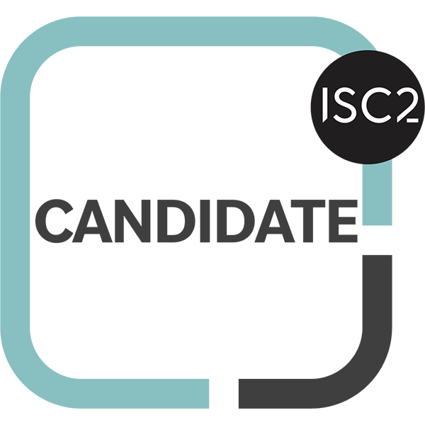
         <strong>(ISC)² Candidate</strong>
      </td>
      <td width="165" valign="bottom">
        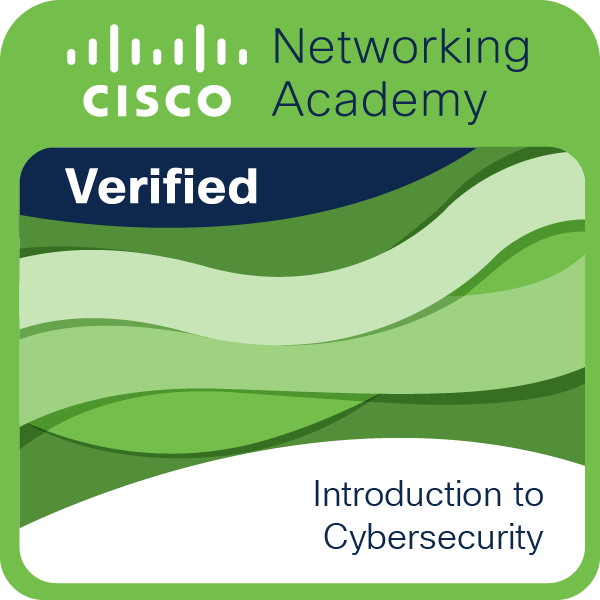
         <strong>Intro to Cyber</strong>
      </td>
      <td width="165" valign="bottom">
        
         <strong>MongoDB AI & Innovation</strong>
      </td>
    </tr>
    <tr align="center">
      <td width="165" valign="bottom">
        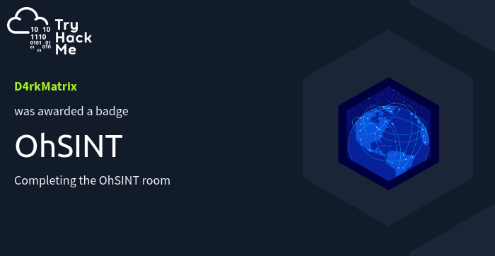
         <strong>OhSINT Investigation</strong>
      </td>
      <td width="165" valign="bottom">
        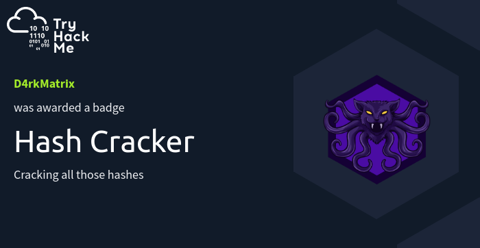
         <strong>Hash & Forensics</strong>
      </td>
      <td width="165" valign="bottom">
        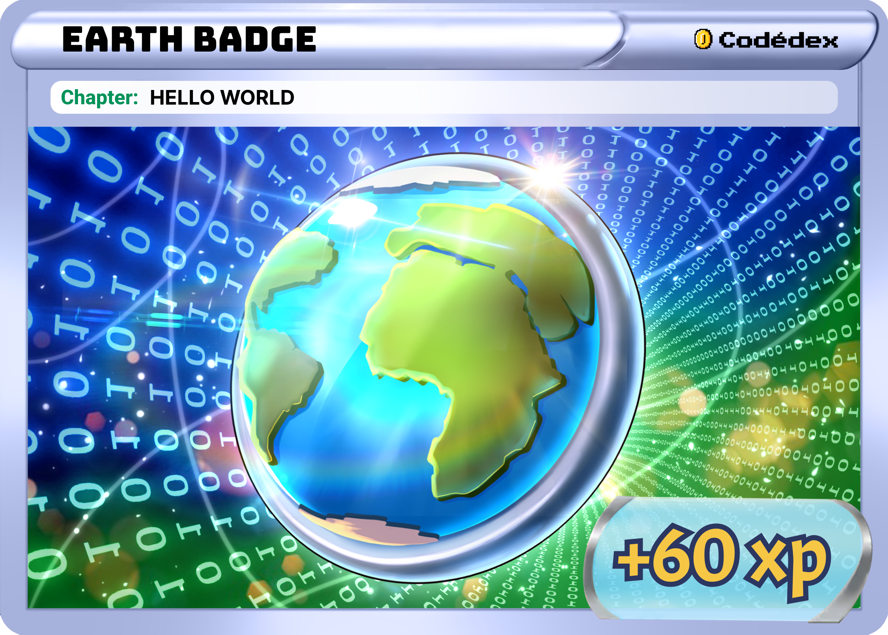
         <strong>Earth Global Rank</strong>
      </td>
      <td width="165" valign="bottom">
        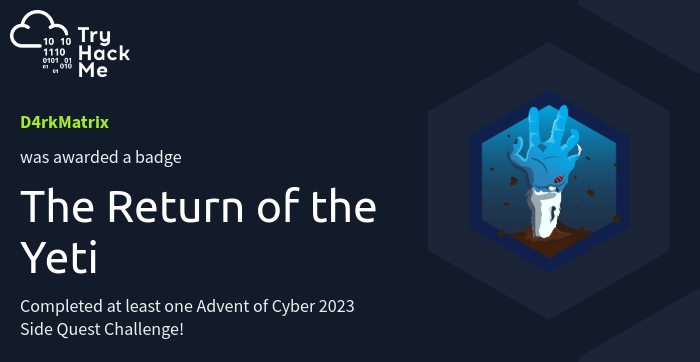
         <strong>Advent of Cyber</strong>
      </td>
    </tr>
    <tr align="center">
      <td width="165" valign="bottom">
        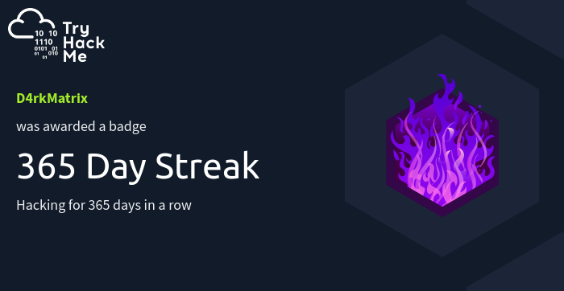
         <strong>365-Day Streak</strong>
      </td>
      <td width="165" valign="bottom">
        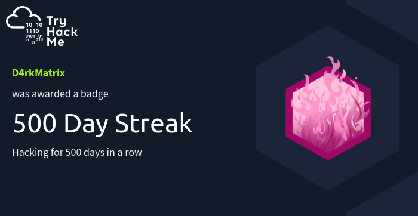
         <strong>500-Day Streak</strong>
      </td>
      <td width="165" valign="bottom">
        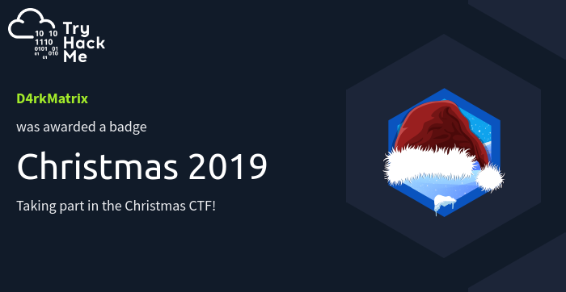
         <strong>Veteran Milestone</strong>
      </td>
      <td width="165" valign="bottom">
        
         <strong>THM Capability Score</strong>
      </td>
    </tr>
  </table>

## 📊 `0x07` // Live Telemetry & Activity

  <!-- GitHub Streak (auto-generated by .github/workflows/update-streak.yml) -->
  

    
  

  <!-- Contribution Snake (auto-generated by .github/workflows/generate-snake.yml) -->
  

    <picture>
      <source media="(prefers-color-scheme: dark)" srcset="./assets/github-snake-dark.svg" />
      <source media="(prefers-color-scheme: light)" srcset="./assets/github-snake.svg" />
      
    </picture>
  

## 🤝 `0x08` // Connect & Collaborate

<table width="100%">
  <tr>
    <td width="55%" valign="middle" align="center">
      
<em>"Where Curiosity Meets Cybersecurity."</em>

      

        I am actively open to collaborations in <strong>Cybersecurity Research</strong>, <strong>Digital Forensics Tooling</strong>, <strong>Full-Stack Product Builds</strong>, and conducting <strong>Cyber Defense Training & Workshops via CYBER DRAVIDA</strong>.
      

      
      
        
      
    </td>
    <td width="45%" valign="middle" align="center">
      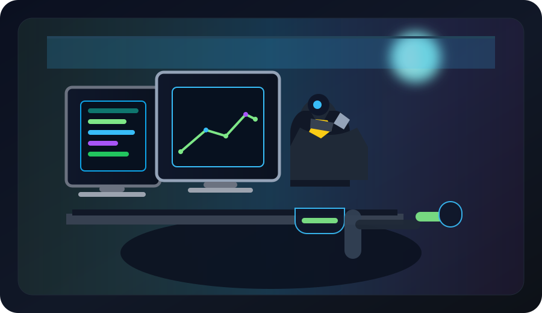
    </td>
  </tr>
</table>

  
<strong>🎮 Off-duty mode — when I lose a game</strong>

   
  

    
  

   
  Founded &amp; Engineered by <strong>Aniket Tegginamath</strong> • CYBER DRAVIDA • 2026 • <a href="#whoami">↑ back to top</a>
  

